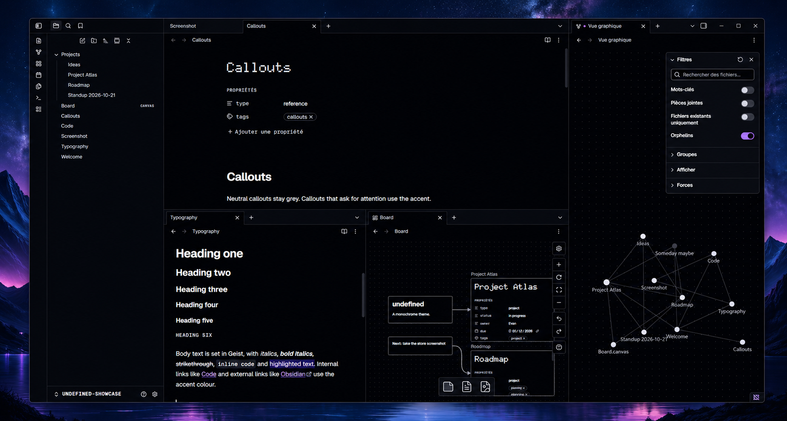

# Undefined

A minimal monochrome theme for Obsidian. Deep black in dark mode, pure white in light mode, and nothing else but your accent colour.



## Features

- Black, white and greys only. Every coloured detail comes from the accent colour set in **Settings → Appearance → Accent color**.
- The accent is automatically shaded to stay readable in both modes, whatever colour you pick.
- Dot-matrix note titles, square list bullets, dotted dividers and bracketed callouts.
- Geist, Geist Mono and Doto are bundled, so the theme works offline and makes no network requests.
- WCAG AA contrast for text, visible keyboard focus, and support for increased-contrast and forced-colors modes.

## Customisation

These variables can be overridden with a CSS snippet:

```css
body {
  --ud-font-display: var(--ud-font-sans); /* plain note titles */
  --ud-tick: 0px;                         /* no callout brackets */
}
.theme-dark, .theme-light {
  --ud-dot: transparent;                  /* no dot grid */
}
```

Fonts chosen in **Settings → Appearance** take priority over the bundled ones.

## License

Theme: MIT. Bundled fonts: SIL Open Font License 1.1, see [fonts/OFL.txt](fonts/OFL.txt).
